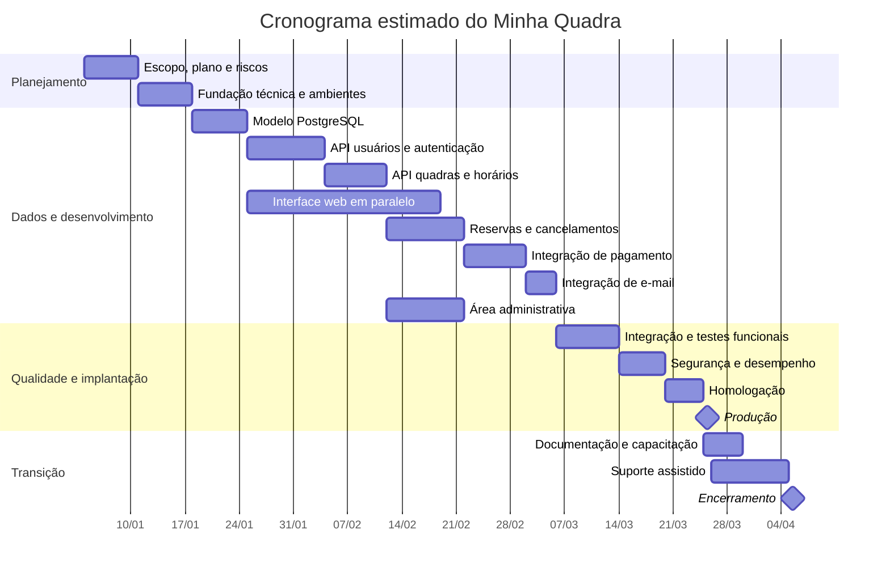

# Minha Quadra — Etapa 2: Plano de Projeto

**Disciplina:** Projetos de Sistemas  
**Instituição:** Centro Universitário de Ensino Superior do Amazonas — CIESA  
**Projeto:** Minha Quadra — Sistema de Reserva de Quadras Esportivas  
**Base:** arquitetura e requisitos definidos na Etapa 1  
**Responsável pelo trabalho individual:** [PREENCHER NOME]  
**Data:** [PREENCHER]

---

## 1. Premissas do plano

Esta etapa transforma a arquitetura definida na Etapa 1 em um plano de projeto. O Minha Quadra continua sendo uma aplicação web cliente-servidor, com React e TypeScript no front-end, Java com Spring Boot na API, PostgreSQL como banco de dados, gateway externo de pagamento e serviço externo de e-mail.

As estimativas abaixo são **premissas acadêmicas de planejamento**, não cotações comerciais. Elas deverão ser revistas quando houver informações reais sobre volume de usuários, preços de fornecedores, disponibilidade da equipe e escopo contratado.

### 1.1 Decisões arquiteturais utilizadas como base

| Decisão da Etapa 1 | Consequência considerada nesta etapa |
|---|---|
| ADR-001 — aplicação web responsiva com React e TypeScript | Criar interface web para clientes e administradores; testar telas a partir de 360 px e navegadores definidos nos RNFs. |
| ADR-002 — PostgreSQL | Planejar modelagem, migrações, índices, transações e testes de concorrência para impedir reservas conflitantes. |
| ADR-003 — autenticação por token | Implementar autenticação, autorização por perfil, validade e renovação dos tokens, além de armazenamento seguro no cliente. |
| C4 nível 2 — API Java + Spring Boot | Implementar API REST e integrar banco, gateway de pagamento e serviço de e-mail. |
| C4 nível 3 — serviços de usuários, quadras, reservas, pagamentos e notificações | Organizar o trabalho em pacotes correspondentes aos componentes e suas integrações. |
| Fluxo de reserva da Etapa 1 | Tratar reserva pendente, aprovação do pagamento, confirmação e envio de e-mail. |

### 1.2 Escopo e limites

O plano contempla levantamento detalhado, construção da aplicação web e da API, banco de dados, integrações, testes, implantação, documentação, capacitação e transição para operação. Não contempla desenvolvimento de aplicativo nativo, criação de um gateway próprio de pagamento ou substituição do serviço externo de e-mail.

A regra RN03 será respeitada: a reserva só passa a confirmada após aprovação do pagamento. A RN02 e a RNF08 exigem controle transacional para evitar duas reservas confirmadas para a mesma quadra, data e faixa de horário.

---

## 2. EAP — Estrutura Analítica do Projeto

A EAP está organizada em três níveis ou mais. Os pacotes de transição também estão incluídos, pois a entrega não termina na disponibilização do sistema.

```mermaid
flowchart TD
    P["0. Minha Quadra — Projeto"]
    P --> A["1. Gestão e planejamento"]
    P --> B["2. Construção da solução"]
    P --> C["3. Verificação e implantação"]
    P --> D["4. Transição e encerramento"]

    A --> A1["1.1 Planejamento"]
    A --> A2["1.2 Acompanhamento"]
    A1 --> A11["1.1.1 Plano, escopo e cronograma"]
    A1 --> A12["1.1.2 Plano de riscos e custos"]
    A2 --> A21["1.2.1 Reuniões e indicadores"]
    A2 --> A22["1.2.2 Controle de mudanças"]

    B --> B1["2.1 Fundação técnica"]
    B --> B2["2.2 Aplicação web"]
    B --> B3["2.3 API e regras de negócio"]
    B --> B4["2.4 Dados e integrações"]
    B1 --> B11["2.1.1 Repositório e ambientes"]
    B1 --> B12["2.1.2 Pipeline e configuração"]
    B2 --> B21["2.2.1 Interface responsiva"]
    B2 --> B22["2.2.2 Área administrativa"]
    B3 --> B31["2.3.1 Usuários e autenticação"]
    B3 --> B32["2.3.2 Quadras e horários"]
    B3 --> B33["2.3.3 Reservas e cancelamentos"]
    B4 --> B41["2.4.1 Modelo PostgreSQL"]
    B4 --> B42["2.4.2 Gateway de pagamento"]
    B4 --> B43["2.4.3 Serviço de e-mail"]

    C --> C1["3.1 Testes"]
    C --> C2["3.2 Implantação"]
    C1 --> C11["3.1.1 Testes funcionais e API"]
    C1 --> C12["3.1.2 Segurança e desempenho"]
    C1 --> C13["3.1.3 Concorrência de reservas"]
    C2 --> C21["3.2.1 Homologação"]
    C2 --> C22["3.2.2 Produção e monitoramento"]

    D --> D1["4.1 Transição"]
    D --> D2["4.2 Encerramento"]
    D1 --> D11["4.1.1 Documentação operacional"]
    D1 --> D12["4.1.2 Capacitação da equipe"]
    D1 --> D13["4.1.3 Observabilidade e suporte inicial"]
    D2 --> D21["4.2.1 Aceite e lições aprendidas"]
    D2 --> D22["4.2.2 Entrega final"]
```

### 2.1 Pacotes de trabalho e rastreabilidade

| ID | Pacote de trabalho | Origem arquitetural / requisito | Entrega verificável |
|---|---|---|---|
| 1.1.1 | Plano, escopo e cronograma | Arquitetura C4 e ADRs da Etapa 1 | Plano aprovado e linha de base |
| 1.1.2 | Plano de riscos e custos | ADR-001, ADR-002, ADR-003 e integrações externas | Registro de riscos e orçamento |
| 2.1.1 | Repositório e ambientes | C4 níveis 1 e 2 | Repositório, ambientes de desenvolvimento e homologação |
| 2.1.2 | Pipeline e configuração | RNF05 — disponibilidade | Processo repetível de integração e publicação |
| 2.2.1 | Interface responsiva | ADR-001, RNF06 e RNF07 | Telas de cadastro, login, consulta e reserva |
| 2.2.2 | Área administrativa | RF09, RF10 e RF11 | Telas de quadras, horários, preços e reservas |
| 2.3.1 | Usuários e autenticação | ADR-003, RF01, RF02, RNF03 e RNF04 | Cadastro, login e controle de acesso por perfil |
| 2.3.2 | Quadras e horários | C4 nível 3, RF03, RF04 e RF10 | API de quadras e disponibilidade |
| 2.3.3 | Reservas e cancelamentos | RF05, RF07, RF08, RN01–RN05 e RNF08 | Fluxo de reserva pendente, confirmação e cancelamento |
| 2.4.1 | Modelo PostgreSQL | ADR-002 e RNF01/RNF08 | Banco, migrações, índices e restrições |
| 2.4.2 | Gateway de pagamento | C4 nível 2, RF06 e RN03 | Integração de pagamento e tratamento de retorno |
| 2.4.3 | Serviço de e-mail | C4 nível 2 e RF12 | E-mail de confirmação e registro de falhas |
| 3.1.1 | Testes funcionais e API | RF01–RF12 | Evidências de testes e correções |
| 3.1.2 | Segurança e desempenho | RNF01–RNF07 e ADR-003 | Relatório de desempenho e verificações de segurança |
| 3.1.3 | Concorrência de reservas | RN02 e RNF08 | Testes comprovando ausência de reservas conflitantes |
| 3.2.1 | Homologação | Todos os requisitos | Aceite dos cenários de negócio |
| 3.2.2 | Produção e monitoramento | RNF05 e C4 nível 2 | Sistema publicado e monitorado |
| 4.1.1 | Documentação operacional | Componentes do C4 nível 3 | Manual técnico, recuperação e operação |
| 4.1.2 | Capacitação da equipe | Competência necessária para operar Java, PostgreSQL e integrações | Treinamento concluído e material de apoio |
| 4.1.3 | Observabilidade e suporte inicial | RNF01, RNF02 e RNF05 | Painéis, alertas e período assistido |
| 4.2.1 | Aceite e lições aprendidas | Plano e critérios de aceite | Termo de aceite e registro de melhorias |
| 4.2.2 | Entrega final | Escopo aprovado | Código, documentação e transferência formal |

### 2.2 Pacote eliminado pela decisão arquitetural

A decisão ADR-001 de utilizar aplicação web responsiva elimina o pacote **“desenvolvimento de aplicativo nativo separado para Android e iOS”**. Esse trabalho não será executado porque uma única aplicação web atenderá computadores, tablets e celulares por navegador. A decisão reduz a necessidade de manter duas bases de código e dois processos de publicação. A experiência dependerá do navegador e da conexão, conforme as consequências negativas registradas no ADR-001.

---

## 3. Cronograma, dependências e caminho crítico

O cronograma abaixo é uma estimativa de planejamento em semanas, considerando início hipotético em 04/01/2027. As durações são dias corridos aproximados para o exercício; feriados, disponibilidade real da equipe e prazos de fornecedores devem ser confirmados antes de uma execução real.

### 3.1 Dependências e justificativas

| Atividade predecessora | Atividade dependente | Justificativa |
|---|---|---|
| Fundação técnica e ambientes | Desenvolvimento da API e da aplicação web | O time precisa de repositório, configuração e ambientes para integrar e testar o código. |
| Modelo PostgreSQL | Serviços de usuários, quadras e reservas | Os repositórios e as regras dependem das tabelas e relacionamentos definidos. |
| Autenticação | Área administrativa e operações protegidas | O sistema precisa identificar cliente e administrador antes de autorizar operações. |
| Quadras e horários | Reserva | A solicitação depende de consultar quadra e disponibilidade. |
| Reserva pendente | Integração de pagamento | O pagamento precisa estar associado a uma solicitação de reserva. |
| Pagamento aprovado | Confirmação e e-mail | A reserva só pode ser confirmada após aprovação do gateway, e o e-mail comunica a confirmação. |
| Desenvolvimento integrado | Testes de ponta a ponta | Os cenários completos exigem interface, API, banco e integrações disponíveis. |
| Testes e homologação | Produção | A publicação depende da correção dos defeitos impeditivos e do aceite. |
| Produção | Capacitação e transição operacional | A equipe deve conhecer o ambiente publicado, os alertas e os procedimentos reais. |

### 3.2 Caminho crítico

O caminho crítico planejado é: **fundação técnica → modelo de dados → API de usuários/quadras/reservas → integração de pagamento → testes integrados → homologação → produção**. Atrasos nessas atividades tendem a deslocar a data final. A interface web e a documentação podem avançar parcialmente em paralelo, desde que os contratos da API estejam definidos.

O marco imóvel do plano é a **data de entrada em operação acordada com o estabelecimento**, que deverá ser confirmada no início do projeto. Se houver uma data comercial ou contratual fixa, mudanças de escopo deverão ser avaliadas sem comprometer os testes de integridade de reservas e pagamento.

### 3.3 Diagrama de Gantt

---

## 4. Custo em três anos

As alternativas comparam duas formas de hospedar e operar a solução. Os valores são estimativas didáticas em reais, não propostas comerciais.

- **Alternativa A — infraestrutura própria:** maior investimento inicial em servidor, configuração e preparação do ambiente; custo anual menor de hospedagem, mas exige manutenção e capacidade dimensionada previamente.
- **Alternativa B — infraestrutura em nuvem com elasticidade:** menor implantação inicial e maior custo anual variável de serviços gerenciados, monitoramento, armazenamento, tráfego e capacidade elástica.

| Alternativa | Implantação | Operação por ano | Total em 3 anos |
|---|---:|---:|---:|
| A — infraestrutura própria | R$ 38.000 | R$ 18.000 | R$ 92.000 |
| B — nuvem com elasticidade | R$ 16.000 | R$ 27.000 | R$ 97.000 |

**Cálculo:** total em três anos = implantação + (operação anual × 3).

- Alternativa A: R$ 38.000 + (R$ 18.000 × 3) = **R$ 92.000**.
- Alternativa B: R$ 16.000 + (R$ 27.000 × 3) = **R$ 97.000**.

A alternativa A apresenta custo estimado total R$ 5.000 menor no período, mas exige investimento inicial maior e capacidade própria. A alternativa B reduz a implantação e facilita ajustar recursos conforme a demanda, mas possui custo operacional anual maior. Para o Minha Quadra, a **Alternativa B é recomendada** caso o estabelecimento não tenha equipe especializada para manter infraestrutura própria e valorize elasticidade e serviços gerenciados. A escolha deverá ser confirmada com cotações e projeção real de acessos.

### 4.1 Premissas de custo

Os valores incluem, como estimativa, preparação de ambiente, hospedagem ou aquisição de infraestrutura, banco de dados, armazenamento, monitoramento, backups, manutenção e suporte técnico básico. Não incluem remuneração integral de uma equipe permanente, taxas variáveis cobradas por transação pelo gateway, tributos específicos ou aquisição de equipamentos dos usuários. Esses itens precisam ser orçados separadamente quando houver dados reais.

---

## 5. Estimativa dos pacotes — técnica PERT

A técnica PERT considera três estimativas: otimista (O), mais provável (M) e pessimista (P).

**Fórmulas:**

- PERT = (O + 4 × M + P) / 6
- Desvio = (P − O) / 6

As estimativas são expressas em dias de trabalho e representam duração de cada pacote, não necessariamente o prazo total do projeto, pois algumas atividades podem ocorrer em paralelo.

| Pacote principal | O | M | P | PERT | Desvio |
|---|---:|---:|---:|---:|---:|
| Fundação técnica e ambientes | 3 | 5 | 9 | 5,3 dias | 1,0 dia |
| Modelo PostgreSQL | 3 | 5 | 9 | 5,3 dias | 1,0 dia |
| API de usuários e autenticação | 5 | 8 | 14 | 8,5 dias | 1,5 dia |
| API de quadras e horários | 4 | 6 | 10 | 6,3 dias | 1,0 dia |
| Reservas e cancelamentos | 5 | 8 | 16 | 8,8 dias | 1,8 dias |
| Integração com gateway | 4 | 7 | 18 | 8,0 dias | 2,3 dias |
| Interface web responsiva | 8 | 12 | 20 | 12,7 dias | 2,0 dias |
| Testes integrados e concorrência | 5 | 8 | 15 | 8,7 dias | 1,7 dias |
| Implantação e monitoramento | 3 | 5 | 10 | 5,5 dias | 1,2 dias |
| Capacitação e transição | 2 | 4 | 8 | 4,3 dias | 1,0 dia |

### 5.1 Incertezas relevantes

A maior incerteza está na integração com o gateway, pois depende de documentação, credenciais, ambiente de testes e prazos de resposta do fornecedor. A integração deve ser iniciada com antecedência e validada em ambiente de homologação. A estimativa pessimista não deve ser ignorada no cronograma.

---

## 6. Riscos

Os riscos abaixo possuem origem, resposta planejada, gatilho e reserva. As reservas de contingência são previstas para riscos identificados e incorporadas à linha de base do projeto. A reserva gerencial é destinada a imprevistos não identificados e depende de autorização da direção.

| ID | Risco e origem | Resposta planejada | Gatilho |
|---|---|---|---|
| R1 | **Arquitetura:** gateway de pagamento indisponível ou com retorno incompatível com o fluxo de reserva. | Mitigar: validar API e ambiente de testes no início; implementar tratamento de timeout, idempotência e conciliação; manter reserva pendente até confirmação confiável. | Falha repetida na homologação ou retorno fora do contrato. |
| R2 | **Arquitetura:** concorrência permite duas solicitações para a mesma quadra e horário. | Mitigar: transações, restrições/controle no banco, validação no serviço de reservas e testes concorrentes. | Teste simultâneo produz duas reservas confirmadas conflitantes. |
| R3 | **Projeto:** atraso na disponibilização de credenciais ou documentação de fornecedor. | Mitigar: solicitar acesso no início e acompanhar prazo; usar ambiente simulado apenas para desenvolvimento, sem substituir homologação real. | Credenciais ou documentação não recebidas na data combinada. |
| R4 | **Equipe:** falta de experiência em Spring Boot, PostgreSQL, segurança ou operação. | Mitigar: capacitação antes das atividades críticas, revisão de código e apoio técnico pontual. | Tarefa crítica bloqueada ou retrabalho recorrente por falta de conhecimento. |
| R5 | **Arquitetura/operação:** desempenho inferior ao RNF01 com até 200 usuários simultâneos. | Mitigar: testes de carga, índices, análise de consultas e ajuste de recursos antes da produção. | 95% das consultas excedem 2 segundos no teste representativo. |
| R6 | **Projeto/operação:** falha no envio de e-mail após pagamento aprovado. | Mitigar: registrar o evento, usar tentativas controladas e fila/reprocessamento; não desfazer pagamento aprovado apenas por falha de e-mail. | Mensagens de confirmação acumuladas ou rejeitadas pelo provedor. |
| R7 | **Equipe/operação:** equipe do estabelecimento não consegue operar cadastros, horários e reservas. | Mitigar: manual, treinamento prático e acompanhamento no início da operação. | Usuário responsável não conclui tarefas essenciais no treinamento. |
| R8 | **Segurança:** exposição de token ou credenciais por armazenamento ou configuração inadequada. | Mitigar: armazenamento seguro, HTTPS, controle de acesso, gestão de segredos e revisão de segurança. | Token ou segredo identificado em log, repositório ou ambiente não autorizado. |

### 6.1 Reservas de contingência e gerencial

- **Contingência (linha de base):** reservar até 10% do esforço de desenvolvimento para riscos identificados, principalmente ajustes da integração de pagamento, correções de concorrência e otimização de desempenho. A utilização deve estar vinculada a um risco registrado e aprovada pelo responsável pelo projeto.
- **Reserva gerencial:** manter uma reserva adicional de até 5% do custo estimado, fora da linha de base, para imprevistos não identificados. Seu uso exige autorização da direção/contratante e atualização do plano.

As porcentagens são premissas acadêmicas para este planejamento e deverão ser validadas com dados reais.

---

## 7. Aquisições — construir ou comprar

A decisão considera custo total, prazo, risco, dependência de fornecedor e capacidade técnica. A Lei nº 14.133/2021 deve ser observada quando a contratação estiver sujeita ao regime de licitações e contratos administrativos; para este exercício, adota-se uma janela de planejamento de **90 dias** para contratação, conforme a orientação fornecida no enunciado. A aplicabilidade e o prazo efetivo devem ser confirmados pela área responsável em uma contratação real.

| Item | Decisão | Justificativa | Prazo estimado / dependência |
|---|---|---|---|
| Aplicação web React | Construir | É parte central do produto e contém a experiência específica do Minha Quadra. | Desenvolvimento interno, conforme cronograma. |
| API Java + Spring Boot | Construir | Implementa regras de negócio próprias, autenticação e fluxo de reserva. | Desenvolvimento interno, conforme cronograma. |
| Banco PostgreSQL | Comprar/usar serviço gerenciado ou instalar solução existente | PostgreSQL é tecnologia escolhida na ADR-002; não faz sentido desenvolver um banco próprio. | Configuração inicial; depende de infraestrutura. |
| Gateway de pagamento | Comprar/contratar serviço externo | Processamento financeiro exige integração especializada e não deve ser implementado do zero. | Planejar até 90 dias para contratação, credenciamento e homologação, conforme premissa do enunciado. |
| Serviço de e-mail | Comprar/contratar serviço externo | Envio transacional é uma capacidade especializada e já prevista na arquitetura. | Contratação e configuração; depende de credenciais e limites do fornecedor. |
| Hospedagem e monitoramento | Comprar serviço em nuvem | Reduz a necessidade de administrar hardware próprio e permite elasticidade. | Contratação/configuração antes da homologação. |
| Capacitação | Construir internamente com apoio pontual | A equipe precisa aprender a operar a solução e seus procedimentos. | Antes da entrada em produção. |

### 7.1 Dependência de fornecedor e plano de saída

A dependência mais relevante é o gateway de pagamento: sem credenciais, documentação e ambiente de homologação, não é possível validar o fluxo completo. O atraso pode deslocar testes e implantação. Para reduzir o impacto, o projeto deve solicitar a contratação e o acesso no início, manter uma interface de integração isolada na API e documentar o contrato utilizado.

Para o serviço de e-mail e hospedagem, devem ser documentados dados de configuração, exportação de registros, backups e procedimentos de migração. O projeto não deve armazenar dados completos de cartão; deve manter apenas identificadores e informações necessárias para consultar a transação, conforme a orientação de segurança da Etapa 1.

---

## 8. Recursos humanos e operação posterior

A equipe deve ter responsabilidades explícitas durante a construção e após a implantação. Os nomes reais dos responsáveis devem ser preenchidos quando forem definidos.

| Papel | Responsabilidade durante o projeto | Responsabilidade depois da implantação |
|---|---|---|
| Gerente/ responsável pelo projeto — [nome] | Planejar escopo, prazo, custos, riscos, comunicação e aceite. | Acompanhar encerramento e transferência para operação. |
| Desenvolvedor front-end — [nome] | Construir interface React/TypeScript e validar responsividade e navegadores. | Corrigir problemas de interface e apoiar melhorias. |
| Desenvolvedor back-end — [nome] | Construir API Spring Boot, autenticação, regras de negócio e integrações. | Corrigir falhas da API e manter integrações. |
| Administrador de banco de dados — [nome] | Modelar PostgreSQL, migrações, índices, backups e testes de concorrência. | Monitorar banco, backups, restauração e desempenho. |
| Responsável por infraestrutura/DevOps — [nome] | Preparar ambientes, publicação, monitoramento e gestão de segredos. | Acompanhar disponibilidade, alertas, atualizações e recuperação. |
| Representante do estabelecimento — [nome] | Validar regras, preços, horários e cenários de negócio. | Operar cadastros, horários, reservas e acompanhar pagamentos. |
| Suporte/operador — [nome] | Participar da homologação e receber capacitação. | Atender dúvidas, registrar incidentes e encaminhar problemas técnicos. |

### 8.1 Capacitação e competência ausente

A capacitação deverá cobrir, no mínimo:

1. Uso da área administrativa para cadastrar quadras, configurar preços e horários.
2. Consulta e acompanhamento de reservas e seus status.
3. Procedimentos para identificar pagamento pendente, aprovado ou com falha.
4. Consulta de logs e alertas, abertura de chamado e escalonamento.
5. Rotina de backup, restauração e resposta a indisponibilidade.

Se a equipe não tiver experiência com operação de PostgreSQL, segurança de tokens ou monitoramento em nuvem, essa competência deverá ser suprida por treinamento e apoio técnico antes da entrada em produção. Estima-se uma capacitação de **16 horas**, distribuída entre demonstração, prática assistida e avaliação de tarefas. O custo correspondente deve ser confirmado com o fornecedor ou instrutor escolhido.

### 8.2 Lei de Brooks e Lei de Conway

A Lei de Brooks alerta que acrescentar pessoas a um projeto atrasado pode aumentar o atraso devido ao tempo de integração e comunicação. Portanto, a resposta principal a atrasos será priorizar escopo, remover bloqueios e reduzir retrabalho; novas pessoas só serão adicionadas quando houver tarefas independentes e tempo para integração.

A Lei de Conway indica que a arquitetura tende a refletir a estrutura de comunicação da organização. Como o Minha Quadra possui componentes separados — interface, API, dados e integrações — as responsabilidades devem ser claras, mas as equipes precisam manter comunicação frequente para evitar que contratos entre componentes fiquem incompatíveis.

---

## 9. Critérios de aceite e encerramento

O Minha Quadra poderá ser considerado pronto para entrada em operação quando:

- Cadastro e login funcionarem conforme RF01 e RF02, com controle de acesso por perfil.
- Clientes consultarem quadras e horários conforme RF03 e RF04.
- A reserva seguir os estados pendente e confirmada conforme RF05, RF06 e RN03.
- O sistema impedir reservas conflitantes conforme RN02 e RNF08, inclusive em solicitações simultâneas.
- Cancelamentos respeitarem RN04 e RN05.
- Administradores gerenciarem quadras, preços, horários e reservas conforme RF09, RF10 e RF11.
- O e-mail de confirmação for solicitado após aprovação do pagamento conforme RF12.
- Os testes de desempenho verificarem a meta do RNF01 e o processamento interno do RNF02.
- HTTPS, hash de senhas e controles de acesso forem verificados conforme RNF03 e RNF04.
- A equipe responsável pela operação concluir a capacitação e receber a documentação.
- Houver backup, monitoramento, procedimento de recuperação e responsável definido.

---

## 10. Conclusão

A Etapa 2 transforma as decisões arquiteturais da Etapa 1 em um plano executável para o Minha Quadra. A EAP decompõe o trabalho em pacotes de construção, verificação e transição; o cronograma identifica dependências e o caminho crítico; a análise de custos compara infraestrutura própria e nuvem ao longo de três anos; e a estimativa PERT torna explícita a incerteza das durações.

O registro de riscos apresenta respostas e gatilhos, enquanto o plano de aquisições identifica dependências externas e a necessidade de antecipar a contratação do gateway. Por fim, a definição de papéis, capacitação e critérios de aceite prepara a transferência para a operação. Assim, o plano mantém rastreabilidade com os ADRs, componentes C4, requisitos funcionais, requisitos não funcionais e regras de negócio da Etapa 1.

---

## 11. Checklist antes da entrega

- [ ] Preencher nome do responsável pelo trabalho individual.
- [ ] Confirmar nomes dos responsáveis ou manter os papéis, se a atividade aceitar essa forma.
- [ ] Confirmar se o professor exige datas reais ou aceita cronograma estimado.
- [ ] Revisar valores de custos e deixar claro que são premissas estimadas.
- [ ] Conferir se os diagramas Mermaid renderizam no GitHub.
- [ ] Salvar este arquivo como `PLANO.md` na raiz do mesmo repositório GitHub da Etapa 1.
- [ ] Enviar o link do arquivo/repositório ao professor até a data indicada na atividade.
